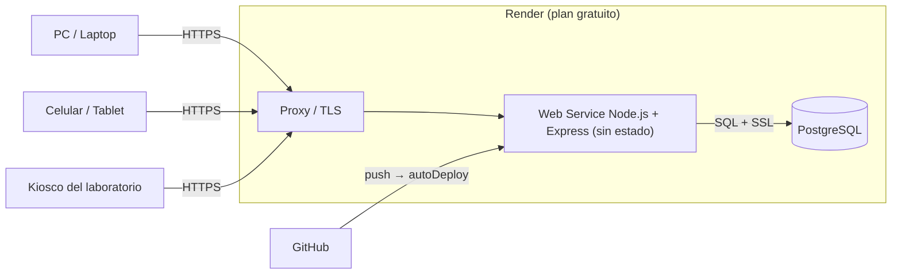
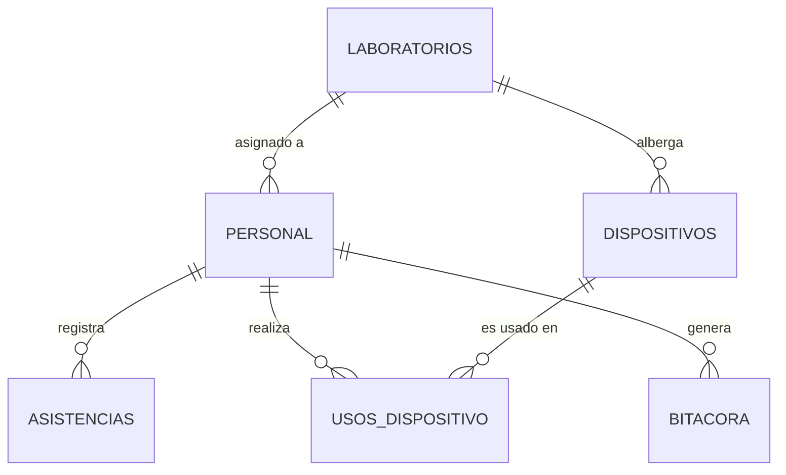

# Arquitectura y fundamentos (Sistemas Distribuidos y Cloud Computing)

## 1. Problema y objetivo
En laboratorios tecnológicos, la asistencia del personal y el uso de equipos costosos suelen registrarse por separado, sin
trazabilidad ni garantías de consistencia. **LabControl** integra ambos dominios: cada uso de un dispositivo queda ligado a una
persona con asistencia vigente, con auditoría completa. Es un servicio cloud, accesible por URL pública desde cualquier dispositivo.

## 2. Vista de despliegue

## 3. Modelo de datos

Invariantes en la base de datos (no solo en la aplicación):
- `UNIQUE (personal_id, fecha)`: una fila de asistencia por persona y día.
- `CHECK (hora_salida >= hora_entrada)`.
- `UNIQUE INDEX ... ON usos_dispositivo(dispositivo_id) WHERE fin IS NULL`: **exclusión mutua** (un uso abierto por dispositivo).

## 4. Decisiones de sistemas distribuidos
| Preocupación | Decisión |
|---|---|
| Escalado horizontal | Servicio **sin estado** (12-factor): las sesiones viven en PostgreSQL (`connect-pg-simple`), no en memoria; se pueden añadir instancias sin cambios. |
| Consistencia | Las reglas críticas se ejecutan en **transacciones** y se respaldan con restricciones del motor. La exclusión mutua del dispositivo se resuelve con `UPDATE ... WHERE estado='disponible'` (bloqueo de fila) + índice único parcial; el que pierde la carrera recibe un error de negocio, no datos corruptos. |
| Idempotencia | La entrada diaria usa `INSERT ... ON CONFLICT`; reintentos o doble clic no duplican registros. El esquema y la semilla son idempotentes. |
| Migraciones concurrentes | `pg_advisory_lock` evita que dos instancias migren al mismo tiempo durante un despliegue. |
| Reloj | La hora oficial es la **del servidor/BD** (`now()`), nunca la del cliente; evita manipulación y desfases entre dispositivos. Zona horaria institucional configurable (`APP_TZ`). |
| Fallos | `/health` verifica la BD; Render reinicia/rotea según ese chequeo. El pool maneja errores de conexión inactiva. |
| Modelo CAP | Una sola BD relacional (CP): ante partición se prioriza consistencia. Es adecuado para asistencia y control de activos. |
| Entrega continua | GitHub → Render `autoDeploy`; infraestructura declarada en `render.yaml` (infraestructura como código). |

## 5. Seguridad (modelo de amenazas resumido)
| Amenaza | Mitigación |
|---|---|
| Fuerza bruta de credenciales | `express-rate-limit` (15 intentos/15 min), bcrypt, comparación en tiempo constante, bitácora de fallos |
| Fijación de sesión | `session.regenerate()` al autenticar; cookie `HttpOnly`, `SameSite=Lax`, `Secure` en producción |
| CSRF | Token sincronizado por sesión, validado con `timingSafeEqual` en todo POST |
| Inyección SQL | Consultas parametrizadas en todo el código |
| XSS | Escape por defecto de EJS + CSP (`helmet`) sin scripts inline |
| Escalada de privilegios | Middleware `requireAdmin` por ruta; el personal solo cierra sus propios usos |
| Inyección de fórmulas en CSV | Prefijo `'` a celdas que comienzan con `= + - @` |
| Manipulación de horas | Marcas de tiempo generadas en servidor |
| Repudio | Bitácora de auditoría con persona, acción, entidad, detalle e IP |

## 6. Métricas de negocio definidas
- **% de asistencia** = (presentes + tardanzas) / días laborables (lun–vie) del rango.
- **Ausencias** = días laborables − (presentes + tardanzas + justificados), con mínimo 0.
- **Horas trabajadas** = Σ (salida − entrada). **Horas de uso** de un dispositivo = Σ (fin − inicio), o hasta ahora si está abierto.

## 7. Limitaciones y trabajo futuro
- Plan gratuito: suspensión por inactividad y BD con vigencia de 30 días.
- Los días feriados no se descuentan de los días laborables (se podría añadir una tabla de calendario).
- Autenticación local; se puede integrar SSO institucional (OIDC) y MFA.
- Marcación por QR/NFC/biometría en el kiosco; notificaciones por correo ante tardanzas.
- Limitador de intentos en memoria: con varias instancias conviene un almacén compartido (Redis/PostgreSQL).
- Observabilidad: añadir logs estructurados y métricas (Prometheus/OpenTelemetry).
